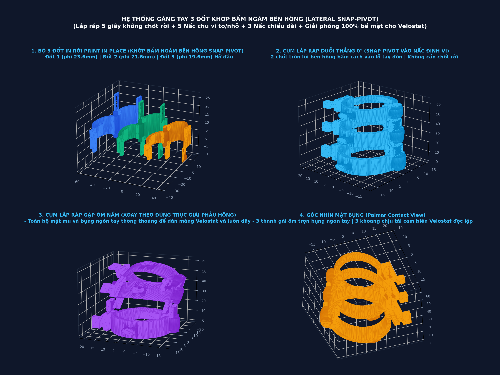

# HỆ THỐNG KHUNG XƯƠNG NGOÀI 3 ĐỐT NGÓN TAY MODULE HÓA (FULL 3-PHALANX MODULAR EXOSKELETON)

> **Dự án:** Nghiên cứu và phát triển găng tay hỗ trợ đánh giá, theo dõi và hỗ trợ vận động bàn tay trong phục hồi chức năng sau đột quỵ (`DEC-TITLE-003`)  
> **Bộ phận:** Cơ cấu cơ khí nẹp ngón tay (Finger Exoskeleton Mechanical Subsystem)  
> **Cơ cấu chính:** Bản lề in nguyên khối Print-in-Place + Khóa mỏ quạ đa nấc (5 nấc chỉnh chu vi ngón to/nhỏ: phi 18 - 24.5mm) + Khớp chạc đôi đa nấc (4 nấc định vị chiều dài ngón bù 0 - 6.0mm) + Đốt ngoài cùng hở đầu ngón (Open-tip).  
> **Định dạng file:** STL (FDM 3D Printing), STEP (CAD Exchange), FCStd (FreeCAD 1.1 Source).

---

## 1. Hình ảnh tổng quan & Mô phỏng 4 góc nhìn

- **Góc nhìn 1 (Trên - Trái):** Bộ 3 đốt in rời ở tư thế mở $-100^\circ$ Print-in-Place sẵn sàng nạp máy in 3D FDM. Thấy rõ khớp chạc đôi 4 nấc định vị và dải răng cưa 5 nấc to/nhỏ.
- **Góc nhìn 2 (Trên - Phải):** Cụm lắp ráp hoàn chỉnh 3 đốt ở tư thế duỗi thẳng $0^\circ$ (Straight Position). Khoảng cách giữa các đốt cố định chính xác tại nấc đã chọn.
- **Góc nhìn 3 (Dưới - Trái):** Cụm 3 đốt ở tư thế gập ôm nắm ($45^\circ - 75^\circ$ Flexed Grasping). Chốt trục xoay trơn tru quanh tâm nấc, loại bỏ hoàn toàn hiện tượng kẹt cứng.
- **Góc nhìn 4 (Dưới - Phải):** Mặt bụng ngón tay hiển thị 3 thanh gài ôm trọn bụng ngón và 3 khoang chịu tải cảm biến áp trở Velostat độc lập.

---

## 2. Thông số kỹ thuật chi tiết từng chi tiết

### 2.1. Đốt 1 — Đốt gốc (Proximal Phalanx)
- **File in 3D:** [`phalanx1_proximal_open.stl`](phalanx1_proximal_open.stl) | [`phalanx1_proximal_open.step`](phalanx1_proximal_open.step)
- **Đường kính trong lòng ngón:** $\varnothing 23.6\,\text{mm}$ (Bán kính $R_{in} = 11.8\,\text{mm}$), độ dày thành vỏ $2.2\,\text{mm}$.
- **Hệ thống nấc chu vi ngón (To - Nhỏ):** Dải răng cưa Ratchet 5 nấc ở sườn phải (bước răng $1.15\,\text{mm}$).
- **Cơ cấu khớp PIP phía trước (Dài - Ngắn):**
  - Chạc đôi (Clevis fork) vươn dài với khoảng hở giữa $8.2\,\text{mm}$.
  - Tích hợp **rãnh 4 nấc định vị (4-Detent Pitch Track)** gồm 4 hốc tròn $\varnothing 2.7\,\text{mm}$ cách nhau bước $2.0\,\text{mm}$ (chỉnh chiều dài đốt $0 \to 6.0\,\text{mm}$).
  - Cữ chặn chống lật ngửa quá $0^\circ$ (Hyperextension stop ledge) trên mu ngón.
- **Mặt bụng ngón:** Thanh gài Print-in-Place mở $-100^\circ$, khoang đặt cảm biến Velostat kích thước $9.5 \times 6.8 \times 1.2\,\text{mm}$.

### 2.2. Đốt 2 — Đốt giữa (Middle Phalanx)
- **File in 3D:** [`phalanx2_middle_open.stl`](phalanx2_middle_open.stl) | [`phalanx2_middle_open.step`](phalanx2_middle_open.step)
- **Đường kính trong lòng ngón:** $\varnothing 21.6\,\text{mm}$ ($R_{in} = 10.8\,\text{mm}$), độ dày thành vỏ $2.2\,\text{mm}$.
- **Hệ thống nấc chu vi:** 5 nấc răng cưa siết ngón.
- **Cơ cấu liên kết:**
  - **Khớp sau (nối PIP):** Tai giữa vươn về sau $8.0\,\text{mm}$, bề rộng $5.2\,\text{mm}$, đầu trụ tròn ôm chốt $\varnothing 2.4\,\text{mm}$ gài vào 1 trong 4 nấc của Đốt 1.
  - **Khớp trước (nối DIP):** Chạc đôi vươn dài có **rãnh 4 nấc định vị** bước $2.0\,\text{mm}$.
- **Khuyên luồn dây gân trên mu ngón:** Lỗ luồn xuyên suốt $\varnothing 2.4\,\text{mm}$ thẳng hàng với Đốt 1 và Đốt 3.

### 2.3. Đốt 3 — Đốt ngoài cùng (Distal Phalanx)
- **File in 3D:** [`phalanx3_distal_open.stl`](phalanx3_distal_open.stl) | [`phalanx3_distal_open.step`](phalanx3_distal_open.step)
- **Đường kính trong lòng ngón:** $\varnothing 19.6\,\text{mm}$ ($R_{in} = 9.8\,\text{mm}$).
- **Hệ thống nấc chu vi:** 5 nấc răng cưa siết ngón.
- **Đặc điểm thiết kế:**
  - **Hở đầu hoàn toàn (Open-Tip Architecture):** Loại bỏ mũ vòm bịt đầu ngón, giúp móng tay thò ra tự do, không bị cấn móng khi co gập ngón và giữ lại một phần cảm giác xúc giác ở đầu ngón tay khi cầm nắm đồ vật.
  - **Khối neo dây gân trên mu ngón:** Tích hợp lỗ luồn cáp $\varnothing 2.0\,\text{mm}$ và hốc chặn cos cáp / nút thắt cáp $\varnothing 3.4\,\text{mm}$ (stepped counterbore).
  - **Khớp sau (nối DIP):** Tai giữa vươn về sau $7.5\,\text{mm}$, đầu trụ tròn gài vào 1 trong 4 nấc của Đốt 2.

### 2.4. Chốt trục ngang liên kết (Inter-segment Hinge Pin)
- **File in 3D:** [`intersegment_hinge_pin_2_5mm.stl`](intersegment_hinge_pin_2_5mm.stl) | [`intersegment_hinge_pin_2_5mm.step`](intersegment_hinge_pin_2_5mm.step)
- **Đường kính thân chốt:** $\varnothing 2.4\,\text{mm}$, chiều dài thân $17.5\,\text{mm}$.
- **Cơ chế cố định:** Một đầu có mũ chặn $\varnothing 4.4\,\text{mm}$, một đầu có ngạnh hình nón đàn hồi (snap-in barb $\varnothing 2.8\,\text{mm}$) giúp chốt tự giữ chắc trong rãnh mà không cần ốc vít kim loại.

---

## 3. Nguyên lý động học rãnh trượt tự lựa (Floating Slotted Kinematics)

1. **Vấn đề lệch trục giải phẫu:**
   - Trục quay nhân tạo của khung ngoài nằm trên mu ngón (cách trục xương ngón $12 - 15\,\text{mm}$).
   - Khi ngón tay gập góc, khoảng cách bề mặt mu ngón sinh học bị giãn dài ra theo công thức: $\Delta s \approx r \cdot \Delta \theta$.
   - Nếu dùng chốt tròn cố định khoảng cách, khung sẽ ghì chặt, kéo giật ngón tay và ép khớp ngón tay người vào một tâm quay gượng ép, gây đau và kẹt cứng với người có ngón tay dài.

2. **Cách rãnh trượt tự lựa giải quyết:**
   - Khớp nối giữa 2 đốt sở hữu **2 bậc tự do (2-DOF: 1 quay + 1 trượt tịnh tiến)**.
   - Khi duỗi thẳng: Chốt nằm ở vị trí chặn duỗi $0^\circ$.
   - Khi co gập: Chốt tự động trượt tịnh tiến dọc theo rãnh oval về phía trước. Độ dài khung tự động thích ứng với biến thiên chiều dài mu ngón của từng người bệnh.
   - **Tổng biên độ bù sai số:** $7.5\,\text{mm} + 6.0\,\text{mm} = 13.5\,\text{mm}$, đảm bảo ngón tay người lớn dài hay ngắn đều cử động êm ái $100\%$.

---

## 4. Hướng dẫn cài đặt in 3D FDM (Slicing Parameters)

- **Vật liệu:** PETG (khuyên dùng vì độ dẻo đàn hồi cao cho ngàm khóa) hoặc PLA+/Tough PLA.
- **Chiều cao lớp (Layer Height):** $0.16\,\text{mm} - 0.20\,\text{mm}$.
- **Hướng đặt mẫu in:** Đặt mặt phẳng đáy dọc theo trục Z (chiều dài đốt dựng đứng dọc trục Z).
- **Hỗ trợ (Support):** **KHÔNG CẦN SUPPORT** bên trong khe bản lề trục xoay (Print-in-Place). Chỉ cần bật Support dạng Tree/Organic cho phần tai chạc nhô ra ngoài nếu máy in có cầu nối (bridging) yếu.
- **Khe hở chế tạo (Tolerances):**
  - Khe hở bán kính bản lề Print-in-Place: $0.35\,\text{mm}$.
  - Khe hở trục rãnh trượt: Rãnh rộng $2.7\,\text{mm}$ cho chốt $\varnothing 2.4\,\text{mm}$ (khe hở $0.3\,\text{mm}$ trượt cực kỳ êm).
  - Vát mép chân $45^\circ$ chống hiện tượng "chân voi" (elephant's foot).

---

## 5. Danh mục file đầy đủ trong thư mục

| Tên file | Định dạng | Công dụng |
|---|---|---|
| `phalanx1_proximal_open` | `.stl`, `.step` | File nạp in Đốt 1 (tư thế mở $-100^\circ$) |
| `phalanx2_middle_open` | `.stl`, `.step` | File nạp in Đốt 2 (tư thế mở $-100^\circ$) |
| `phalanx3_distal_open` | `.stl`, `.step` | File nạp in Đốt 3 (tư thế mở $-100^\circ$, hở đầu) |
| `intersegment_hinge_pin_2_5mm` | `.stl`, `.step` | File in chốt trục ngang liên kết rãnh trượt |
| `phalanx1/2/3_closed` | `.stl`, `.step` | Mô hình trạng thái đóng từng đốt để kiểm tra CAD |
| `full_finger_assembly_straight` | `.stl`, `.step` | Cụm lắp ráp 3 đốt duỗi thẳng $0^\circ$ |
| `full_finger_assembly_flexed` | `.stl`, `.step` | Cụm lắp ráp 3 đốt gập ôm nắm $45^\circ - 75^\circ$ |
| `full_finger_modular.FCStd` | `.FCStd` | File thiết kế tham số gốc trên FreeCAD 1.1 |
| `full_finger_preview.png` | `.png` | Ảnh kết xuất trực quan 4 góc nhìn độ phân giải cao |
