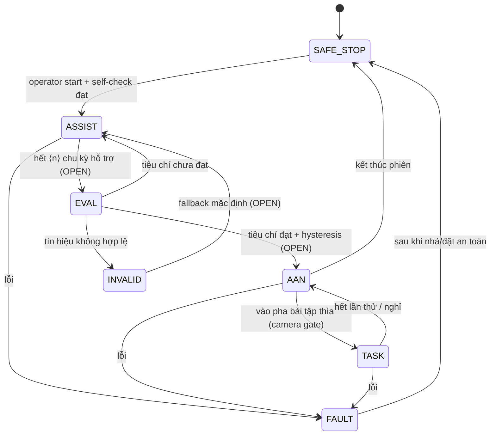

# 10 — Gate 0: Tờ yêu cầu tác vụ và bảng trạng thái (task/state sheet)

> **Ngày lập:** 2026-10-19 · **Trạng thái:** `DRAFT — PROPOSED`, chờ chủ dự án/nhóm nghiên cứu duyệt. Đây là artifact Gate 0 theo [`research/context/IMPLEMENTATION_PIPELINE.md`](../context/IMPLEMENTATION_PIPELINE.md) §3 Gate 0 và [`protocols/09`](09_AAN_spool_phantom_and_conditional_volunteer.md) §3.
> **Căn cứ:** `DEC-REHAB-001`, `DEC-SENSE-001`, `DEC-AAN-002`, `DEC-SCOPE-007/008`, [`CURRENT_DESIGN_BASELINE.md`](../context/CURRENT_DESIGN_BASELINE.md).
> **Quy tắc bằng chứng (bắt buộc):** **không một ô số nào trong tài liệu này được chốt**. Mọi ô số ghi `OPEN` kèm cột "căn cứ cần có để chốt". Target ≠ result. Dữ liệu mô phỏng/tổng hợp ≠ số đo vật lý. Không suy ra an toàn, hiệu quả lâm sàng, novelty hay "đã dùng tại nhà" từ tài liệu này.
> **Kèm theo:** bản đồ kênh ở [`10a_gate0_channel_map_and_acquisition_budget.md`](10a_gate0_channel_map_and_acquisition_budget.md) + [`10b_channel_map_proposed.csv`](10b_channel_map_proposed.csv).

---

## 1. Tài liệu này giải quyết việc gì

Gate 0 trong pipeline yêu cầu **đóng băng tác vụ đầu tiên và yêu cầu hệ thống** trước khi chế tạo/đo. Ba artifact phải có:

1. Tờ yêu cầu/trạng thái tác vụ một trang → **mục 2–4** dưới đây.
2. Bản đồ kênh cảm biến → tài liệu `10a`/`10b`.
3. Sơ đồ ngón ↔ cảm biến ↔ actuator → **mục 7**.

Nguyên tắc xuyên suốt: một hạng mục chỉ được chuyển từ `OPEN` sang `CHỐT` khi có **căn cứ** nêu ở cột cuối (quyết định chủ dự án, phép đo bench có log, hoặc tài liệu thiết kế đã rà). Agent không tự điền.

---

## 2. Định nghĩa tác vụ thìa — các ô cần chốt

### 2.1. Vật thể (thìa)

| Hạng mục | Giá trị | Trạng thái | Căn cứ cần có để chốt |
|---|---|---|---|
| Loại thìa | thìa ăn cơm / thìa cà phê / thìa trẻ em / thìa in 3D riêng | `OPEN` | Chủ dự án chọn; ưu tiên vật dụng thật có sẵn tại nhà để đúng bối cảnh thiết kế |
| Chiều dài toàn phần | ⟨mm⟩ | `OPEN` | Cân/đo vật thật, ghi vào phiếu đo kèm ảnh |
| Khối lượng | ⟨g⟩ | `OPEN` | Cân thật; đây là đầu vào cho thiết kế cơ cấu, **không** phải giới hạn lực an toàn |
| Chiều rộng/bề dày cán tại điểm cầm | ⟨mm⟩ | `OPEN` | Đo thật; quyết định khe ngàm nẹp ngón |
| Vật liệu & màu | ⟨…⟩ | `OPEN` | Cần tương phản với nền và vùng đích để nhánh thị giác hoạt động (xem `docs/07`) |
| Có đánh dấu nhận dạng hay không | marker thụ động / không | `OPEN` | Nếu dùng marker thì phải khai báo là "tác vụ có hỗ trợ marker", không được mô tả như nhận dạng vật thể tổng quát |

### 2.2. Vùng xuất phát và vùng đích

| Hạng mục | Giá trị | Trạng thái | Căn cứ cần có để chốt |
|---|---|---|---|
| Bề mặt thao tác | bàn phẳng, vật liệu/màu | `OPEN` | Chọn cố định để giảm biến thiên ánh sáng/nền |
| Vùng xuất phát (vị trí thìa ban đầu) | kích thước + vị trí ⟨mm⟩ | `OPEN` | Vẽ/khuôn mẫu vật lý; phải nằm trong tầm với của người tập ngồi |
| Vùng đích | kích thước + hình dạng + cách đánh dấu | `OPEN` | Khuôn in/đánh dấu nhìn thấy được bằng camera; tiêu chí "trong vùng đích" phải định nghĩa được bằng hình học, không bằng cảm tính |
| Khoảng cách xuất phát → đích | ⟨mm⟩ | `OPEN` | Đo thật; là tham số tác vụ, không phải chỉ số phục hồi |
| Độ cao nhấc tối thiểu được tính là "lift" | ⟨mm⟩ | `OPEN` | Chốt cùng tiêu chí camera ở `docs/07`; cần phương pháp xác nhận (thước tham chiếu trong cảnh) |
| Số vùng đích | 1 | đề xuất | Nhiều vùng đích = mở rộng tương lai (mục 6) |

### 2.3. Cách cầm (grasp form)

| Hạng mục | Giá trị | Trạng thái | Căn cứ cần có để chốt |
|---|---|---|---|
| Kiểu cầm | ba ngón cái–trỏ–giữa (tripod) cầm vào cán thìa | đề xuất theo `DEC-REHAB-001` | Chủ dự án xác nhận; nếu đổi kiểu cầm phải sửa lại nẹp + tuyến dây |
| Vị trí đặt từng ngón trên cán | ⟨mm từ đầu cán⟩ | `OPEN` | Đánh dấu trên vật thật + chụp ảnh; dùng làm mốc cho Gate 1 |
| Ngón nào do actuator nào kéo | xem sơ đồ mục 7 | `OPEN` | Phụ thuộc thiết kế tang/đường dây (protocol 09 §7 còn OPEN) |
| Cho phép tay còn lại hỗ trợ không | không | đề xuất | Chốt để tránh nhiễu khi diễn giải tín hiệu |

### 2.4. Định nghĩa thả và hoàn thành

| Nhãn | Định nghĩa đề xuất | Trạng thái | Căn cứ cần có để chốt |
|---|---|---|---|
| `PLACE_OK` | thìa nằm trong vùng đích, không tiếp xúc tay, giữ được ≥ ⟨s⟩ | `OPEN` (thời gian giữ) | Chốt cùng tiêu chí camera; thời gian giữ phải ngắn hơn chu kỳ ghi hình |
| `RELEASE` | người tập mở ngón để thìa rời tay | `OPEN` | Xác định bằng tổ hợp tín hiệu nào (Flex/Velostat/camera) phải khai báo trước |
| `DROP` | thìa rơi ngoài vùng đích | đề xuất | — |
| `MISPLACE` | thìa chạm bề mặt nhưng ngoài vùng đích | đề xuất | — |
| `UNKNOWN` | camera bị che khuất / mất vật thể / độ tin cậy thấp | đề xuất | Không được suy `UNKNOWN` thành thất bại; phải ghi riêng (mục 4, nhãn `T_UNKNOWN`) |

### 2.5. Chỉ dẫn cho người tập (script) — `OPEN`

Cần một đoạn chỉ dẫn cố định, đọc/nghe giống nhau ở mọi phiên, gồm: tư thế ngồi, vị trí tay ban đầu, cách nghe/nhìn phản hồi, điều phải làm khi hệ thống dừng, và câu nói rõ **đây là bài tập kỹ thuật trên thiết bị thử, không phải đánh giá phục hồi**. Nội dung chữ phải do nhóm/chủ dự án viết và duyệt; agent không tự soạn lời thay nhóm.

### 2.6. Cấu trúc phiên

| Hạng mục | Giá trị | Trạng thái | Căn cứ |
|---|---|---|---|
| Số lần thử / phiên | ⟨n⟩ | `OPEN` | Phải đủ cho thống kê mô tả nhưng không gây mỏi; chốt sau khi thử pilot trên phantom |
| Thời gian nghỉ giữa các lần thử | ⟨s⟩ | `OPEN` | Chốt cùng người có chuyên môn PHCN (không nêu danh tính trong hồ sơ nộp — `DEC-ROLE-001`) |
| Giới hạn thời gian một lần thử (timeout) | ⟨s⟩ | `OPEN` | Cần để máy trạng thái không treo; **không** phải tiêu chí lâm sàng |
| Thứ tự chế độ trong phiên | assisted → auto-transition → AAN → task | đề xuất | `DEC-REHAB-001` |
| Điều kiện dừng phiên | xem mục 4 `FAULT`/`SAFE_STOP` | `OPEN` | Phải rà an toàn riêng (protocol 09 §3) |

### 2.7. Giả định bối cảnh tại nhà

Thiết kế hướng tới luyện tập tại nhà cho người trung niên sau đột quỵ. **Đây là bối cảnh mục tiêu, chưa phải khả năng dùng tại nhà đã xác nhận.** Các giả định phải khai báo và sau này kiểm tra:

| Giả định | Trạng thái | Ghi chú |
|---|---|---|
| Camera cố định, vị trí lặp lại được (giá kẹp/đế) | đề xuất | Nếu người nhà tự bố trí mỗi lần một khác, nhánh thị giác cần bước hiệu chuẩn nhanh |
| Ánh sáng trong nhà, không điều khiển được hoàn toàn | `OPEN` | Phải ghi lại điều kiện ánh sáng trong log; kiểm tra độ nhạy ở Gate 3 |
| Người tập tự đeo/tháo được trong ⟨phút⟩ | `OPEN` | Liên quan cơ cấu đóng/mở nẹp (`docs/06` §4, Mech 9 chưa in thử) |
| Có người nhà hiện diện khi tập | `OPEN` | Câu hỏi thiết kế/an toàn, **không** thay cho phê duyệt thử nghiệm người |
| Không yêu cầu KTV thao tác chuyển chế độ | đã chốt | `DEC-REHAB-001` |

---

## 3. Nhãn trạng thái tác vụ (task-state labels)

Dùng chung cho camera (`docs/07`), bộ điều khiển và log. Mỗi nhãn phải có **nguồn bằng chứng** khai báo trước; nhãn không có bằng chứng quan sát được thì không được gán.

| Mã nhãn | Mô tả | Nguồn bằng chứng chính | Bằng chứng bổ sung | Gán được khi | Trường log tối thiểu |
|---|---|---|---|---|---|
| `T_READY` | tay ở vị trí bắt đầu, thìa ở vùng xuất phát | camera | Flex ở mốc duỗi | cả hai điều kiện đạt | `t_ms, mode, task_state, conf` |
| `T_APPROACH` | các ngón tiến về cán thìa | camera | Flex tăng dần | — | + `flex_raw[3], velo_raw[n]` |
| `T_CONTACT` | có tiếp xúc ngón–thìa | camera (nếu quan sát được) | Velostat biến thiên | nếu camera không phân biệt được → để `T_UNKNOWN`, không suy từ Velostat một mình | + lý do gán nhãn |
| `T_GRASP` | thìa được giữ ổn định giữa ba ngón | camera | Flex/Velostat | `OPEN`: tiêu chí giữ ổn định | + `conf` |
| `T_LIFT` | thìa rời bề mặt, cao hơn ngưỡng ⟨mm⟩ | camera | — | ngưỡng `OPEN` (mục 2.2) | + `bbox`, `lift_ref` |
| `T_TRANSFER` | thìa đang di chuyển về vùng đích | camera | — | — | + vận tốc ảnh (không phải vận tốc thật nếu chưa hiệu chuẩn tỷ lệ) |
| `T_PLACE` | thìa được đặt xuống vùng đích | camera | — | — | + `zone_id` |
| `T_RELEASE` | thìa rời tay | camera | Flex/Velostat giảm | `OPEN` | + `conf` |
| `T_SUCCESS` | `PLACE_OK` theo mục 2.4 | camera | — | sau khi `T_PLACE` + `T_RELEASE` | + thời gian tác vụ |
| `T_FAIL_DROP` | rơi trong lúc nhấc/di chuyển | camera | — | — | + pha xảy ra rơi |
| `T_FAIL_MISPLACE` | đặt ngoài vùng đích | camera | — | — | — |
| `T_UNKNOWN` | không đủ bằng chứng (che khuất, mất vật thể, độ tin cậy thấp) | camera | — | mặc định khi không gán được nhãn khác | + `conf`, lý do |
| `T_INVALID_SIGNAL` | tín hiệu cảm biến ngoài dải hợp lệ / trôi vượt mức cho phép | acquisition | — | `OPEN`: dải hợp lệ xác định ở Gate 1 | + kênh lỗi |

**Quy tắc diễn giải:**
- Không gán `T_CONTACT`/`T_GRASP` chỉ từ Velostat. Velostat là bằng chứng áp lực/tiếp xúc **tương đối**, không tự nhận biết ý định (`CLM-SENSE-001`).
- `T_UNKNOWN` là nhãn hợp lệ, phải được đếm và báo cáo riêng; không gộp vào thất bại.
- Nhãn tác vụ **không** phải chỉ số phục hồi; chúng chỉ mô tả thiết bị và bài tập.

---

## 4. Máy trạng thái chế độ vận hành (mode supervisor) — đề xuất



| Trạng thái | Ý nghĩa | Đầu vào quyết định | Đầu ra actuator | Điều kiện rời trạng thái |
|---|---|---|---|---|
| `SAFE_STOP` | mặc định khi khởi động/dừng; dây chùng, servo không giữ lực | self-check, lệnh operator | không kéo | chỉ sang `ASSIST` khi self-check đạt và fixture sẵn sàng |
| `ASSIST` | máy hỗ trợ gập–duỗi theo chu kỳ/biên độ thiết kế | bộ phát chu kỳ nội bộ | kéo + nhả có giới hạn hành trình | sang `EVAL` theo quy tắc đếm `OPEN` |
| `EVAL` | đánh giá tiêu chí chuyển mode trên cửa sổ quan sát | Flex (biên độ/lặp lại), Velostat (nỗ lực/tiếp xúc), camera (pha) | giữ hành vi của trạng thái trước đó | `ASSIST` / `AAN` / `INVALID` |
| `AAN` | người tập khởi xướng, máy chỉ bù phần thiếu | tín hiệu vận động + pha tác vụ | trợ lực có giới hạn, **không** đóng ngón trọn vẹn theo lệnh camera | sang `TASK`, hoặc về `ASSIST` nếu mất tiêu chí (hysteresis `OPEN`) |
| `TASK` | luyện gắp–nhấc–di chuyển–đặt thìa | nhãn trạng thái tác vụ | hỗ trợ theo pha | hết lần thử / `FAULT` |
| `INVALID` | tín hiệu không tin cậy | cờ hợp lệ kênh | về hành vi an toàn đã định trước | fallback `OPEN` (đề xuất: về `ASSIST`, không tự tăng trợ lực) |
| `FAULT` | lỗi phần cứng/cơ khí/vượt hành trình | watchdog, giới hạn hành trình, mất khung camera | dừng + nhả (cơ cấu nhả **không** chỉ dựa phần mềm — protocol 09 §3.2) | `SAFE_STOP` sau kiểm tra |

**Ràng buộc thiết kế bất biến (đã chốt ở baseline, không phải OPEN):**
1. Không có thao tác KTV/nút chuyển chế độ trong luồng vận hành; chuyển chế độ là tự động theo quy tắc đã khóa trước.
2. Camera có thể gate pha tác vụ và gắn nhãn kết quả, nhưng **không** được trực tiếp ra lệnh kéo không giới hạn. Giới hạn hành trình/dừng/nhả nằm ở tầng thấp, độc lập với suy luận thị giác.
3. Hệ thống **không** được coi chuyển động do actuator tạo ra là vận động tự nguyện (mục 5).
4. Không dùng Velostat làm tham chiếu lực an toàn; không khôi phục `F_assist=max(0,F_target−F_active)` hay ngưỡng 5 N.
5. Mọi ngưỡng/cửa sổ/hysteresis phải được **khóa + băm phiên bản cấu hình trước khi đánh giá** (xem `docs/08` §quy tắc pre-registration).

---

## 5. Phân biệt vận động tự nguyện với chuyển động do máy tạo ra — **đã chọn M3 (2026-10-20), chưa kiểm chứng**

Đây là điểm rủi ro logic cao nhất của "tự động chuyển sang AAN": nếu bộ điều khiển đếm chu kỳ do chính servo tạo ra, nó sẽ tự thăng cấp cho người tập không có vận động chủ động. Các phương án dưới đây là **ứng viên**. Ngày **2026-10-20 chủ dự án chọn M3** làm phương pháp làm việc (`DEC-TASK-002` ADOPTED); M3 **chưa được kiểm chứng bằng dữ liệu nào** và mọi thông số của nó còn `OPEN`. Bốn phương án kia chưa được chọn, giữ lại để đối chiếu:

| # | Phương pháp ứng viên | Cần gì | Điểm yếu phải kiểm tra |
|---|---|---|---|
| M1 | Chuỗi thử có/không trợ lực xen kẽ trên phantom: so biên độ Flex khi servo ra lệnh và khi servo im | fixture + log đồng bộ | không tự động áp dụng được cho người thật nếu chưa xác nhận |
| M2 | Dùng lệnh servo làm biến giải thích: phần biên độ Flex không giải thích được bởi lệnh servo được coi là đóng góp của người tập | log lệnh servo + Flex cùng đồng hồ | trễ cơ khí/đàn hồi dây có thể làm sai phần dư; cần đo trễ |
| M3 | Cửa sổ "thăm dò tự nguyện": tạm ngưng trợ lực một khoảng ngắn, đo đáp ứng | quy tắc an toàn + tiêu chí dừng | khoảng ngưng bao lâu là `OPEN`; phải rà an toàn |
| M4 | Đối chiếu pha tác vụ từ camera: chỉ xét tự nguyện khi người tập tương tác vật thể | nhánh thị giác đạt Gate 3 | camera không thấy được nỗ lực không tạo chuyển động |
| M5 | Tín hiệu dòng/mô-men servo làm proxy tải cơ học | phần cứng đo dòng + hiệu chuẩn | là phép đo cơ cấu, **không** phải lực ngón; không thay tham chiếu lực độc lập |

### 5.1. Điều kiện áp dụng M3 (đã duyệt 2026-10-20 — `DEC-TASK-002`)

M3 = **cửa sổ "thăm dò tự nguyện"**: bộ điều khiển tạm ngưng trợ lực trong một khoảng ngắn, đo đáp ứng của người tập trong khoảng đó, rồi quyết định có chuyển chế độ hay không.

Chọn phương pháp **không** đồng nghĩa với việc đã có quy tắc. Những mục sau vẫn `OPEN` và phải chốt bằng quyết định có ngày hoặc bằng dữ liệu bench/phantom:

| # | Thông số/điều kiện của M3 | Trạng thái | Ai/căn cứ chốt |
|---|---|---|---|
| 1 | Độ dài cửa sổ ngưng trợ lực (ms) | `OPEN` | pilot trên phantom, kèm rà an toàn |
| 2 | Tần suất mở cửa sổ (mỗi chu kỳ / mỗi N giây / theo pha tác vụ) | `OPEN` | như trên |
| 3 | Tiêu chí "có đáp ứng tự nguyện" trong cửa sổ (đặc trưng + ngưỡng) | `OPEN` | **chỉ sau** khi có dữ liệu hiệu chuẩn Gate 1 |
| 4 | Hành vi khi cửa sổ hết mà không thấy đáp ứng (giữ ASSIST / giảm dần / về `SAFE_STOP`) | `OPEN` | chủ dự án + rà an toàn |
| 5 | Giới hạn hành trình và cơ cấu nhả phải bảo vệ khoảng ngưng này | `OPEN` | `DEC-MECH-007`, Gate 2 |
| 6 | Số lần lặp tối thiểu trước khi chuyển `ASSIST→AAN` | `OPEN` | Gate 4 |

**Ràng buộc an toàn:** ngưng trợ lực giữa chừng là hành vi có thể làm thay đổi tải lên ngón. Không chạy M3 trên người (kể cả người khỏe) trước khi có rà an toàn và phê duyệt theo `protocols/09` §5; mọi lần thử M3 trong giai đoạn này là trên **giàn/phantom**.

**Giới hạn đã biết của M3:** phương pháp này chỉ thấy đáp ứng **tạo ra chuyển động**. Nỗ lực đẳng trường (gồng mà không dịch chuyển) có thể không bị M3 phát hiện; vì vậy M1 (đối chứng có/không trợ lực trên phantom) hoặc M4 (pha tác vụ từ camera) có thể cần làm lớp kiểm tra chéo. **Chưa duyệt** việc kết hợp này.

**Yêu cầu:** chọn phương pháp, mô tả cách xác nhận trên bench/phantom, rồi mới được đặt đặc trưng/ngưỡng. Không chọn ngưỡng trước khi có phương pháp phân biệt.

---

## 6. Chức năng must-have và mở rộng tương lai

| Nhóm | Hạng mục | Trạng thái phạm vi |
|---|---|---|
| Must-have (Gate 0–5) | hỗ trợ gập–duỗi ba ngón cái/trỏ/giữa | trong phạm vi |
| Must-have | tự động chuyển sang AAN theo quy tắc khóa trước | trong phạm vi |
| Must-have | bài tập thìa: gắp–nhấc–di chuyển–đặt vào 1 vùng đích | trong phạm vi |
| Must-have | phản hồi trực quan tức thời (thành công/thử lại) | trong phạm vi |
| Must-have | log truy vết: raw + trạng thái + lệnh + nhãn + timestamp chung | trong phạm vi |
| Must-have | dừng/nhả an toàn và xử lý tín hiệu không hợp lệ | trong phạm vi |
| Mở rộng tương lai (không phải tiêu chí nghiệm thu hiện tại) | nhiều vật thể / nhiều vùng đích / bài tập khác | ngoài phạm vi |
| Mở rộng tương lai | điều khiển độc lập lực từng ngón ở mức cao | ngoài phạm vi tới khi Gate 2 rõ |
| Mở rộng tương lai | tọa độ metric 3D / mô hình độ sâu đơn ảnh | chỉ khi tác vụ cần (`docs/07` §depth) |
| Mở rộng tương lai | RL / chính sách thích ứng | **không** nằm trong phạm vi đã chốt |
| Mở rộng tương lai | Lượng tử hóa INT8 / NPU trên Orange Pi 5 Pro | **không** nằm trong phạm vi (`DEC-EDGE-001`) |
| Ngoài phạm vi tuyệt đối ở giai đoạn này | thử trên bệnh nhân, claim hiệu quả lâm sàng, claim an toàn được chứng nhận, claim novelty/"đầu tiên", claim đã dùng tại nhà | cấm |

---

## 7. Sơ đồ ngón ↔ cảm biến ↔ actuator (artifact Gate 0 #3)

```text
                NGÓN CÁI (thumb)          NGÓN TRỎ (index)         NGÓN GIỮA (middle)
 Cảm biến gập   FLEX_TH  (1 Flex)         FLEX_IDX  (1 Flex)       FLEX_MID  (1 Flex)
                → biến thiên gập–duỗi/tư thế; KHÔNG phải góc giải phẫu nếu chưa hiệu chuẩn
 Áp lực/tiếp xúc VELO_TH-* (vị trí OPEN)  VELO_IDX-* (OPEN)        VELO_MID-* (OPEN)
                → bằng chứng áp lực/tiếp xúc TƯƠNG ĐỐI tại vị trí lắp; không Newton, không "ý định"
 Actuator      dây → tang ⟨chung/riêng: OPEN⟩ → servo cuốn dây trực tiếp (không lò xo/SEA, không khớp 4 khâu)
                chiều kéo: gập. Chiều duỗi/hồi dây: CƠ CẤU RIÊNG, CÒN OPEN (protocol 09 §3.2)
 Nhiệm vụ      giữ cán thìa (đối chiếu)   giữ cán thìa             giữ cán thìa
 Ô tham chiếu  REF_1 trên nẹp cổ tay, không chịu tải người dùng → theo dõi trôi hệ thống
```

Bảng ánh xạ chi tiết theo kênh MUX: [`10b_channel_map_proposed.csv`](10b_channel_map_proposed.csv).

**Câu hỏi còn mở ở sơ đồ này:** một tang kéo cả ba ngón (đơn giản, nhưng không độc lập) hay ba tang/ba servo (độc lập hơn, nặng và phức tạp hơn)? Đây là quyết định cơ khí có hệ quả trực tiếp tới khối lượng cụm đeo tay (mục tiêu 80–120 g) và tới khả năng tạo dáng cầm tripod — cần chủ dự án chốt trước Gate 2.

---

## 8. Danh sách `OPEN` và người chốt

| # | Hạng mục OPEN | Người/căn cứ chốt | Khối bị chặn nếu chưa chốt |
|---|---|---|---|
| 1 | Bộ thông số thìa + vùng xuất phát/đích + tiêu chí `PLACE_OK` | chủ dự án (đo vật thật) | Gate 1, Gate 3, Gate 5 |
| 2 | Kiểu cầm và vị trí ngón trên cán | chủ dự án (+ ý kiến chuyên môn PHCN, không nêu danh tính) | nẹp ngón, tuyến dây |
| 3 | Cấu trúc phiên: số lần thử, nghỉ, timeout | chủ dự án sau pilot phantom | Gate 5 |
| 4 | ~~Số phần tử Velostat~~ **đã chốt theo PA-2 (2026-10-20): 6 phần tử, 2/ngón (lòng + mu)**; **vị trí lắp vẫn `OPEN`** | chủ dự án + kết quả Gate 1 (ngón–vật vs ngón–nẹp) | bản đồ kênh `10a`, firmware |
| 5 | ~~Flex đi qua MUX hay ADC1 riêng~~ **đã chốt 2026-10-20: Flex qua MUX (PA-2)**; PA-3a chỉ là kiểm tra phần cứng tuỳ chọn, muốn đổi phải duyệt lại | `DEC-CHMAP-001` (ADOPTED) | bản đồ kênh, ngân sách quét |
| 6 | ~~Phương pháp phân biệt tự nguyện vs máy~~ **đã chọn M3 (2026-10-20)**; **còn `OPEN`:** độ dài/tần suất cửa sổ, tiêu chí đáp ứng, hành vi khi không thấy đáp ứng, số lần lặp, rà an toàn | `DEC-TASK-002` (ADOPTED) + §5.1 | đặc trưng/ngưỡng chuyển mode |
| 7 | Đặc trưng, ngưỡng, cửa sổ, số chu kỳ, hysteresis, fallback | **chỉ chốt sau** khi có dữ liệu hiệu chuẩn bench/phantom; khóa + băm phiên bản trước đánh giá | Gate 4 |
| 8 | ~~một tang hay ba tang~~ **đã chốt: BA TANG RIÊNG + servo nhả dây chủ động (2026-10-20, `DEC-MECH-007`)**; **còn `OPEN`:** một động cơ ba tang hay ba động cơ, đường kính tang/hành trình/giới hạn, hành vi nhả khi mất nguồn, cân lại khối lượng | thiết kế cơ khí + rà an toàn | Gate 2 |
| 9 | Tham chiếu lực/căng dây độc lập + quy trình hiệu chuẩn | thiết bị đo độc lập (không Velostat) | Gate 2, mọi phát biểu về lực |
| 10 | Tiêu chí đạt/dừng của phiên phantom | rà an toàn có trách nhiệm | Gate 5 |

---

## 9. Ghi log tối thiểu từ Gate 1 trở đi

Mỗi phiên phải có `session_manifest` (theo `research/bench/templates/session_manifest.csv`) và các bản ghi có:

- `bench_session_id`, `utc_start`, `operator_code` (không định danh người tham gia), `firmware_hash`, `config_version_hash`, `layout_revision`;
- thô: `adc_raw` từng kênh + `t_capture_ms` trên một đồng hồ chung;
- dẫn xuất: đặc trưng Flex/Velostat, cờ hợp lệ kênh;
- điều khiển: `mode`, `task_state`, `conf`, `servo_cmd`, giới hạn hành trình đang áp dụng;
- tham chiếu độc lập (nếu có): thiết bị, giá trị, locator hiệu chuẩn;
- kết quả: nhãn tác vụ, thời gian, rơi/thử lại, sự kiện trợ lực, sự kiện dừng/nhả;
- khai báo nguồn dữ liệu: `REAL_BENCH` / `PHANTOM` / `SIMULATED` — **bắt buộc**, để không lẫn mô phỏng với số đo.

File log gốc không bao giờ bị sửa; bản tính lại đặt tên `…_derived.csv` (quy tắc `research/bench/logs/README.md`). Không tạo file log giả trong `research/bench/logs/`.

---

## 10. Tài liệu này KHÔNG cho phép kết luận gì

- Không phải bằng chứng Gate 0 đã "pass": đây là bản đề xuất chờ duyệt.
- Không xác nhận nguyên mẫu đã chế tạo, đã chạy, đã an toàn.
- Không cho phép phát biểu về phục hồi chức năng, thần kinh, hiệu quả lâm sàng, sử dụng tại nhà đã xác nhận.
- Không cấp phép thử có cấp nguồn trên người (kể cả người khỏe). Xem `protocols/09` §5.
- Mọi con số trong các mục trên là ô trống có chủ đích; việc điền số phải đi kèm căn cứ đo/quyết định và ngày tháng.
